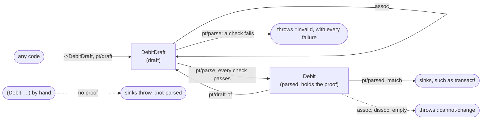

# parsed-types

Code that validates checks a map, then passes the same map along. Nothing ties the check to the code that relies on
it. Three bugs are easy to write: check one id and use another, forget the check, or change the map after the check.
So how does a value prove it was checked? This library answers with a parsed type, such as `Debit`, that only `parse`
can make. The value carries its own proof. A sink such as `transact!` accepts a `Debit`, and refuses a `DebitDraft`,
a plain map, or a value built by hand. `parse` runs pure checks before it touches the world, and batches every fetch.
Every mistake throws an error that names the fix.

This is [parse, don't validate](https://lexi-lambda.github.io/blog/2019/11/05/parse-don-t-validate/) for Clojure,
enforced at run time.

## Each thing has two types, and only `parse` turns the draft into the parsed value

`defparsed` defines `Debit`, the parsed type, and `DebitDraft`, its draft: unchecked input that anyone can build. A
function takes one or the other, never "a map, maybe checked".



| | `DebitDraft` | `Debit` |
|---|---|---|
| Build one | `(->DebitDraft ...)`, `(pt/draft Debit {...})` | only `pt/parse` |
| Read a field | `(:amount x)`, destructuring; a key that isn't a field throws | the same |
| Change it | `assoc` returns a new draft | throws; use `pt/draft-of`, `assoc`, then `pt/parse` |
| A sink accepts it | no | yes |

## You declare the checks once, and sinks accept only parsed values

```clojure
(ns bank
  (:require [db]
            [parsed-types.core :as pt]))

;; your lookup, described below
(defn accounts-by-id [tuples]
  (into {} (map (fn [[id :as t]] [t (db/account id)])) tuples))

;; debit: take money out of an account the user owns, if it holds enough
(pt/defparsed Debit [user-id account-id amount]
  (pure ::amount-positive "The amount is a positive decimal."
        [amount]
        (and (decimal? amount) (pos? amount)))
  (external ::owns-account "The user owns the account."
            [user-id] [account ::account]
            (= user-id (:owner account)))
  (external ::covers-amount "The account holds the amount."
            [amount] [account ::account]
            (<= amount (:balance account 0M)))
  (fetch ::account [account-id] accounts-by-id))

;; credit: put money into any open account
(pt/defparsed Credit [user-id account-id amount]
  (pure ::amount-positive "The amount is a positive decimal."
        [amount]
        (and (decimal? amount) (pos? amount)))
  (external ::account-open "The account exists and is open."
            [] [account ::account]
            (= :open (:status account)))
  (fetch ::account [account-id] accounts-by-id))

;; a transaction is a debit or a credit, and nothing else
(pt/defsum Transaction [Debit Credit])

(defn transact! [transaction]
  (pt/match Transaction transaction
    Debit  debit  (db/add-to-balance! (:account-id debit) (- (:amount debit)))
    Credit credit (db/add-to-balance! (:account-id credit) (:amount credit))))

(defn handle-debit [{:keys [user-id body]}]
  (transact! (pt/parse (pt/draft Debit {:user-id    user-id
                                        :account-id (:account body)
                                        :amount     (:amount body)}))))
```

A check's argument vector names the fields it reads. An `external` check also binds fetches, as in
`[account ::account]`. A check passes only when it returns exactly `true`. Pure checks run in the order written, and
a failed one holds every later pure check that shares a field with it. So write a check on fewer fields first:
`defparsed` refuses a check written before one that reads a proper subset of its fields.

`defsum` names a closed set of parsed types. `match` runs a branch only for a value `parse` made. A `match` that
leaves out a member doesn't compile, so adding a member to the sum breaks every `match` that misses it.

`accounts-by-id` is your lookup. It takes every distinct tuple of the fields the fetch names, and returns a map from
each tuple to its result, nil when nothing exists.

## The value carries its proof, so each bug becomes an error

A parsed value has a hidden field that `parse` sets to a private token. Nothing hands the token out. The field isn't
a key, so it stays out of `seq`, printing and hashing. Equality reads it, so a value `parse` made never equals one
built by hand:

```clojure
(def debit (pt/parse (->DebitDraft :ada 1 5M)))

(= debit (pt/parse (->DebitDraft :ada 1 5M))) ;; => true
(= debit (Debit. :ada 1 5M nil))              ;; => false
```

The parsed type has no `->Debit` factory, and a value built with `(Debit. ...)` has no proof.

| Bug | What happens |
|---|---|
| The caller skips the checks: `(transact! {:account-id 1, :amount 1000M})` | throws `::not-parsed` |
| The caller passes the draft: `(transact! (->DebitDraft :ada 1 1000M))` | throws `::not-parsed` |
| The caller builds the value by hand: `(transact! (Debit. :ada 1 1000M nil))` | throws `::not-parsed` |
| The caller checks one account and debits another | can't happen: `transact!` reads `:account-id` from the `Debit` the checks saw |
| The caller changes the value after the check: `(assoc debit :account-id 9)` | throws `::cannot-change` |
| The sink misspells a field: `(:acount-id debit)` | throws `::no-field`, and suggests `:account-id` |
| The handler misspells a field in a literal `pt/draft` | doesn't compile |

Three more rules hold:

- **Fields hold immutable values, all the way down.** `parse` refuses an atom, an array, a `java.util.Date`, a
  mutable Java collection, or a lazy seq. The message names the fix, such as `(vec s)`. There is no opt-out yet.
- **A walk fails loudly.** `empty` throws, so `clojure.walk` over a parsed value throws instead of dropping the
  proof. Use `(into {} x)` for a plain map.
- **Types reload like records, and a stale one says what to reload.** Parsed types compare by class, so
  `instance?` works, inside a check too. Re-evaluating a `defparsed` makes new classes, and code evaluated before
  keeps the old ones. Where a class doesn't match but its name does, the library throws `::stale-type`. The message
  names what to re-evaluate: the parent `defparsed`, the `defsum`, the namespace a `match` was compiled in, or the
  code that built an old value.

## Parse spends each check once, and touches the world last

1. Pure checks. Malformed input stops here, and never queries the database.
2. Fetches. Each fetch runs once per declaration, with each distinct tuple once. `parse-all` batches many drafts the
   same way.
3. External checks.

After `parse`, the proof travels with the value. A sink checks the proof with `pt/parsed` or `match`, and runs no
check again.

A failure reports every check by name. `:blocked` names the checks that didn't run because of it:

```clojure
(pt/parse (->DebitDraft :ada 1 -5M))
;; throws ex-info "Invalid Debit: 1 check failed: :bank/amount-positive ...", with ex-data:
{:type         :parsed-types.core/invalid
 :rule         :parsed-types.rule/checks-failed
 :failed-kinds #{:pure}
 :draft        "bank.DebitDraft"
 :failures     {:bank/amount-positive {:doc      "The amount is a positive decimal."
                                       :returned false
                                       :blocked  [:bank/owns-account :bank/covers-amount]}}}
```

## One parse checks a whole tree, and holds a parent check over a failed child

```clojure
;; a journal entry: transactions by one user whose debits and credits balance
(pt/defparsed JournalEntry [user-id lines]
  (children lines Transaction)
  (pure ::balanced "The debits and the credits add up to the same amount."
        [lines]
        (= (reduce + 0M (map :amount (filter #(instance? Debit %) lines)))
           (reduce + 0M (map :amount (filter #(instance? Credit %) lines)))))
  (pure ::one-user "Every line is made by the entry's user."
        [user-id lines]
        (every? #(= user-id (:user-id %)) lines)))

(defn post-entry! [entry]
  (run! transact! (:lines (pt/parsed JournalEntry entry))))
```

`lines` holds `DebitDraft`s and `CreditDraft`s. `(child field Type)` declares a field that holds one draft, or nil.

- **Children first.** A parent check sees each child after the child's pure checks pass. Inside the check, the child
  has no proof yet, so `pt/parsed` and `match` refuse it.
- **A failed child holds its parent.** The child's failure appears at its path, `{:lines {0 {...}}}`. A parent check
  that reads the child is held, with `:blocked-by [[:lines 0]]`.
- **One query per fetch, not per child.** The `::account` lookups of 50 debits are one call, with each distinct
  account id once.
- **Parsed all the way down.** A parsed `JournalEntry` holds parsed `Debit`s and `Credit`s, ready for `transact!`.

## Every mistake throws an error that names the rule and the fix

Each error is an `ex-info`. Its ex-data has a `:type` in `parsed-types.core` and a `:rule` in `parsed-types.rule`.
The message states what happened, the rule, and the fix as code:

```
Debit has no field :acount-id. Did you mean :account-id? A key that is not a field throws, never reads nil. Read one
of its fields [:user-id :account-id :amount], as in (:account-id x).
```

A person, or an agent, can apply the fix from the message alone.

| `:type` | Thrown when |
|---|---|
| `::invalid` | a check failed; `:failures` has each one |
| `::not-parsed` | a sink, `match` or `draft-of` got a value `parse` didn't make |
| `::stale-type` | a class from before a REPL re-evaluated a `defparsed` met one from after; the message says what to reload |
| `::cannot-change` | code called `assoc`, `dissoc` or `empty` on a parsed value |
| `::no-field` | code read a key that isn't a field |
| `::bad-input` | `pt/draft` got no literal map or unknown keys, a field holds a mutable value, or a tree is too big |
| `::bad-declaration` | a `defparsed` or `match` has an error, found when it expands or loads |
| `::bad-fetch` | a fetch returned no entry for a tuple |

`defparsed` builds and checks its plan when it loads, so a declaration error never waits for the first `parse`.

The library has no HTTP status codes. A handler maps `:type` to its own responses:

```clojure
(defn debit-route [request]
  (try
    (handle-debit request)
    {:status 200}
    (catch clojure.lang.ExceptionInfo e
      (let [{:keys [type failed-kinds failures]} (ex-data e)]
        (cond
          (not= ::pt/invalid type) (throw e)
          (:pure failed-kinds)     {:status 400, :body failures}
          :else                    {:status 403, :body failures})))))
```

## Accepted limits: the library stops mistakes, not attackers or races

- **Reflection can forge.** `setAccessible` can read or write the proof field.
- **The token's var.** Code can var-quote the private token, `@#'parsed-types.core/parse-token`, and build a value
  with it. The shipped clj-kondo config flags this.
- **`with-redefs`.** Rebinding a library fn changes what the library checks.
- **Reader syntax fails closed.** `#bank.Debit[...]` builds a value without the proof, and `pt/parsed` refuses it.
- **`in-ns` can redefine a type.** Code that switches into a namespace can re-evaluate its `defparsed` with other
  checks. That is how a REPL reload works. Another namespace can't take the name: that throws when it loads.
- **External checks can go stale.** A balance that passed at `parse` can change later. Parse right before you act.

## The API is ten names

| Name | Does |
|---|---|
| `defparsed` | defines `Name`, `NameDraft` with `->NameDraft`, and the checks between them |
| `draft` | builds a draft from a literal map that names every field, and only fields |
| `parse`, `parse-all` | checks drafts and returns parsed values, or throws with every failure |
| `parsed`, `parsed?` | returns or tests a value `parse` made |
| `draft-of` | turns a parsed value back into a draft |
| `defsum`, `match` | a closed set of parsed types, and a branch over every member |
| `declaration` | returns the declaration `defparsed` wrote, as data |

[docs/guarantees.md](docs/guarantees.md) lists each guarantee with its test, every error rule, REPL reload behavior
and the design decisions.

```
clojure -X:test
```
