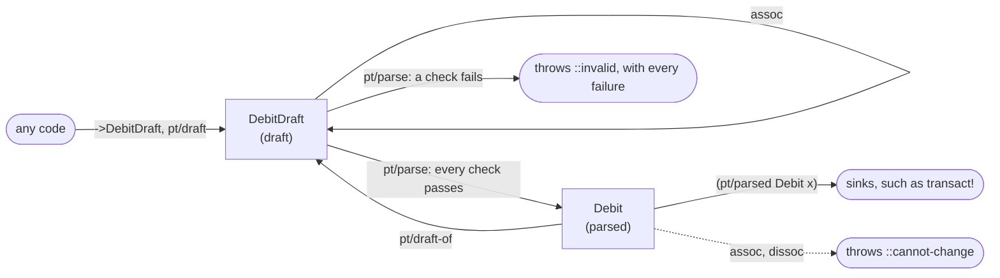

# parsed-types

A function that acts on checked data takes a parsed value, and only `parse` makes one. Holding a parsed value proves
its checks passed, for exactly the fields you read from it.

The library has five goals:

- **The value remembers the check.** A `Debit` proves its checks passed. No flag, no comment, no convention.
- **The type says what is passed around.** A function takes a `Debit` or a `DebitDraft`, never "a map, maybe checked".
- **No check is wasted.** Pure checks run before anything touches the world. Fetches are batched. You parse once and
  pass the proof along.
- **It is plain Clojure.** Read fields with keywords, edit drafts with `assoc`, write checks as ordinary forms.
- **A mistake is an error that names the fix.** A misspelled key throws. Nothing quietly returns nil.

Code that validates checks a map and then passes the same map along. Nothing ties the check to the code that relies
on it. Three bugs are easy to write: check one id and use another, forget the check, or change the map after the
check. In a typed language you'd [parse, don't validate](https://lexi-lambda.github.io/blog/2019/11/05/parse-don-t-validate/).
You turn input into a type that only checked data can have, and the compiler refuses the rest. This library gives
Clojure that type, and refuses the rest at run time.

## Two types for each thing: a draft and a parsed value

| Term | Meaning |
|---|---|
| **Draft** | Unchecked input, such as `DebitDraft`. Anyone builds one. Its fields are fixed. |
| **Parse** | Run every check on a draft. Return a new parsed value, or throw with every failure. |
| **Parsed value** | Checked output, such as `Debit`. Only `parse` makes one, and it can't change. |
| **Check** | A function of named fields that passes by returning exactly `true`. *Pure* checks read only fields; *external* checks read the world. |
| **Fetch** | A batched lookup that external checks use, called once for many drafts. |
| **Sink** | A function that acts, such as `transact!`. It accepts only parsed values. |



| | Draft | Parsed value |
|---|---|---|
| Make one | `->DebitDraft`, `pt/draft` | only `pt/parse` |
| Read a field | `(:amount d)`; a key that isn't a field throws | the same |
| Change it | `assoc`, keeping the passes of checks that don't read the field | throws: use `pt/draft-of`, `assoc`, `pt/parse` again |
| A sink accepts it | no | yes |
| Equal to | a draft of its type with the same fields | a value of its type with the same fields; never a plain map |

**Proof is `pt/parsed`, never equality.** Equality compares values, and a `Debit` built by hand has the same value
as one `parse` made. Never decide "was this checked?" with `=`, a set, or a map lookup.

## Example: a debit reaches the database only after its checks pass

```clojure
(require '[parsed-types.core :as pt])

;; debit: take money out of an account the user owns, if it holds enough
(pt/defparsed Debit [user-id account-id amount]
  (pure ::amount-positive "The amount is a positive decimal."
        [amount]
        (and (decimal? amount) (pos? amount)))
  (external ::owns-account "The user owns the account."
            [user-id] [account ::account]
            (= user-id (:owner account)))
  (external ::covers-amount "The account holds the amount."
            [amount] [account ::account]
            (<= amount (:balance account 0M)))
  (fetch ::account [account-id] accounts-by-id))

;; credit: put money into any open account
(pt/defparsed Credit [user-id account-id amount]
  (pure ::amount-positive "The amount is a positive decimal."
        [amount]
        (and (decimal? amount) (pos? amount)))
  (external ::account-open "The account exists and is open."
            [] [account ::account]
            (= :open (:status account)))
  (fetch ::account [account-id] accounts-by-id))

;; a transaction is a debit or a credit, and nothing else
(pt/defsum Transaction [Debit Credit])

(defn transact! [transaction]
  (pt/match Transaction transaction
    Debit  debit  (db/add-to-balance! (:account-id debit) (- (:amount debit)))
    Credit credit (db/add-to-balance! (:account-id credit) (:amount credit))))

(defn handle-debit [{:keys [user-id body]}]
  (transact! (pt/parse (pt/draft Debit {:user-id    user-id
                                        :account-id (:account body)
                                        :amount     (:amount body)}))))
```

`defparsed` defines the parsed type `Debit`, its draft `DebitDraft`, and the checks between them. A check's argument
vector is the fields it reads; using any other field doesn't compile. An external check also binds fetches,
`[account ::account]`, like `let`. `accounts-by-id` is your lookup, described under the run order below.

`defsum` names a closed set of parsed types. `match` picks the branch for the value's type and binds the value, so
the branch reads its fields with `(:amount debit)`. A `match` that leaves out a member, or names a type that isn't
one, doesn't compile. Each branch runs only on a value `parse` made.

Each bug from above now fails:

| Bug | What happens |
|---|---|
| A caller skips the checks: `(transact! {:account-id 1, :amount 1000M})` | throws `::not-parsed`: `parse` didn't make it |
| A caller builds the type by hand: `(transact! (->Debit :ada 1 1000M))` | throws `::not-parsed`, for the same reason |
| A caller changes it after the check: `(assoc debit :account-id 9)` | throws `::cannot-change` |
| The sink reads a field that doesn't exist: `(:acount-id debit)` | throws `::no-field` |
| The handler misspells a field: `{:acount-id (:account body) ...}` | doesn't compile |
| A new kind of transaction is added to the sum, and `transact!` doesn't handle it | doesn't compile |

## Parse runs pure checks first, and touches the world only if they all pass

1. Pure checks, a field's own checks before checks that relate two fields.
2. Fetches. A fetch takes every distinct tuple of the fields it reads and returns a map from each tuple to a result:
   `[[1] [7]] -> {[1] {...}, [7] {...}}`.
3. External checks.

Malformed input never queries the database. A failure reports every check by name:

```clojure
(pt/parse (->DebitDraft :ada 1 -5M))
;; throws, and the ex-data includes:
{:type         ::pt/invalid
 :failed-kinds #{:pure}
 :failures     {::amount-positive {:doc      "The amount is a positive decimal."
                                   :returned false
                                   :blocked  [::owns-account ::covers-amount]}}}
```

`:blocked` names the checks that didn't run because of this failure. `:failed-kinds` says whether pure checks,
external checks, or both failed. `:draft` names the draft class.

## A draft can hold drafts, and one parse covers the whole tree

```clojure
;; a journal entry: transactions by one user whose debits and credits balance
(pt/defparsed JournalEntry [user-id lines]
  (children lines Transaction)
  (pure ::one-user "Every line is made by the entry's user."
        [user-id lines]
        (every? #(= user-id (:user-id %)) lines))
  (pure ::balanced "The debits and the credits add up to the same amount."
        [lines]
        (= (reduce + 0M (map :amount (filter #(instance? Debit %) lines)))
           (reduce + 0M (map :amount (filter #(instance? Credit %) lines))))))

(defn post-entry! [entry]
  (run! transact! (:lines (pt/parsed JournalEntry entry))))
```

`lines` holds `DebitDraft`s and `CreditDraft`s, and `parse` checks the entry and every line in it together:

- **Children first.** A parent check sees each child as a value of its parsed type that passed its pure checks. The
  value isn't issued yet, so `pt/parsed` and `match` refuse it inside the check. The child's external checks may still
  fail. A child's failure appears at its path, `{:lines {3 {...}}}`. The parent checks that read the child are held,
  with `:blocked-by` naming it.
- **One query per fetch, not per child.** The `::account` lookups of 50 debits are one call, with each distinct
  account id once. The credits' lookups are one more.
- **Bottom-up result.** The parsed `JournalEntry` holds parsed `Debit`s and `Credit`s, so `post-entry!` can hand each
  one to `transact!`.

`(child field Type)` declares a field that holds one draft, or nil. A sum works in `children`, `child`, `pt/parsed`
and `pt/parsed?`. `pt/draft` needs a member type, not a sum.

## Edit a draft with `assoc`

A draft remembers which pure checks it passed. `assoc`, `assoc-in`, `update` and `merge` keep the passes of the checks
that don't read the changed field. `parse` then reruns only what the edit could affect, plus every external check. To
change a parsed value, go back to a draft:

```clojure
(-> debit pt/draft-of (assoc :amount 45M) pt/parse)
```

## Every error has a `:type`, and the caller decides what it means

Each exception the library throws has a `:type` in its ex-data, a keyword in `parsed-types.core`. Its message names
the fix.

| `:type` | When | What to do |
|---|---|---|
| `::invalid` | a check failed | read `:failures`, and tell the user |
| `::not-parsed` | `pt/parsed`, `match` or `draft-of` got a value `parse` didn't make | parse a draft; don't build the parsed type by hand |
| `::cannot-change` | `assoc` or `dissoc` on a parsed value | use `pt/draft-of`, `assoc`, then `pt/parse` |
| `::no-field` | code read a key that isn't a field | fix the key |
| `::bad-input` | `pt/draft` got a non-map or unknown keys, or a tree is over the size limits | reject the input |
| `::bad-declaration` | first use of a declaration found an error in it | fix the declaration |
| `::bad-fetch` | a fetch returned no entry for a tuple | return an entry for every tuple, nil if nothing exists |
| `::stale-type` | at the REPL, a parent was defined against an older version of a child type | re-evaluate the parent |

An exception from your own check or fetch passes through `parse` unchanged.

The library has no HTTP status codes. An HTTP handler maps the types to its own responses:

```clojure
(defn debit-route [request]
  (try
    (handle-debit request)
    {:status 200}
    (catch clojure.lang.ExceptionInfo e
      (let [{:keys [type failed-kinds failures]} (ex-data e)]
        (cond
          (not= ::pt/invalid type)  (throw e)
          (:pure failed-kinds)      {:status 400, :body failures}
          :else                     {:status 403, :body failures})))))
```

## It stops mistakes, not attackers or races

- **Code in the same JVM that sets out to forge proof:** var-quote into private state, `with-redefs`, or reflection.
  The library stops mistakes, not attackers inside the process.
- **A check that reads something it didn't name:** an atom, or a mutable value inside a field. Pure checks are
  remembered, so they must depend only on immutable fields.
- **Time between check and use:** a permission revoked after `parse` isn't seen. Parse right before you act.

## API

| Name | Does |
|---|---|
| `defparsed` | defines `Name`, `NameDraft`, and the checks |
| `draft` | builds a draft from a map; a literal map must name every field, and only fields |
| `parse`, `parse-all` | checks drafts and returns parsed values, or throws with every failure |
| `parsed`, `parsed?` | returns or tests a value `parse` made |
| `draft-of` | turns a parsed value back into a draft, known to pass its pure checks |
| `check`, `check-all`, `passed-checks` | runs or inspects some checks on a draft |
| `defsum`, `match` | a closed set of parsed types, and a branch on it |

[docs/guarantees.md](docs/guarantees.md) lists each guarantee and its test, the compile-time errors, REPL reload
behavior, and the design decisions.

```
clojure -X:test
```
