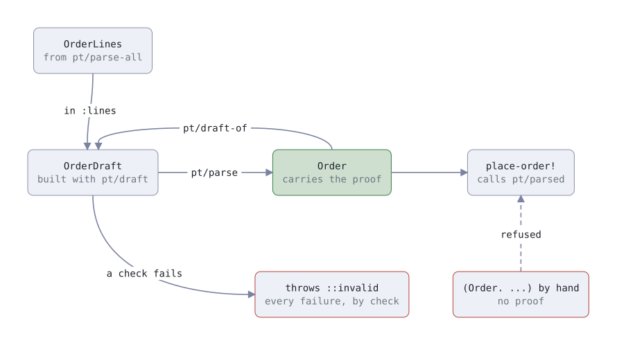

# parsed-types

Clojure code often checks a map, then passes the same map along. Nothing ties the check to the code that relies on
it. Code can check one id and use another, skip the check, or change the map after it. How does a value prove it
was checked? In parsed-types, each kind of checked data gets two types: a draft that any code can build, and a
parsed type that only `parse` can make. The parsed value carries its own proof. A function that acts on checked data,
such as `place-order!`, takes only the parsed type and refuses anything else.
Three values decide each choice the library makes. Explicitness: what you read in the source is what runs. Clarity:
one name per thing, and the type says what is passed around. Good for agents: mistakes fail at compile or load time
where they can, and every error the library throws states the fix as code.

The idea is the smart constructor, or
[parse, don't validate](https://lexi-lambda.github.io/blog/2019/11/05/parse-don-t-validate/), for Clojure.

## Install it as a git dependency

parsed-types needs Clojure 1.11 or later, and is tested on JDK 21. Add it to `deps.edn`:

```edn
{:deps {io.github.escherize/parsed-types {:git/tag "v0.1.0" :git/sha "3b9f4d7"}}}
```

The API may change before 1.0. Report bugs and questions at
[GitHub issues](https://github.com/escherize/parsed-types/issues).

## Only `parse` turns a draft into a parsed value

`defparsed` defines `Quantity`, the parsed type, and `QuantityDraft`, its draft. `restock!` takes only a `Quantity`:

```clojure
(ns warehouse
  (:require [parsed-types.core :as pt]))

(pt/defparsed Quantity [n]
  (pure ::positive "The quantity is a positive integer."
        [n]
        (pos-int? n)))

(defn restock! [quantity]
  (let [{:keys [n]} (pt/parsed Quantity quantity)]
    [:restocked n]))

(restock! (pt/parse (pt/draft Quantity {:n 3}))) ;; => [:restocked 3]
(pt/parse (pt/draft Quantity {:n 0}))            ;; throws ::pt/invalid
(restock! {:n 3})                                ;; throws ::pt/not-parsed
```

A check passes only when its body returns exactly `true`. `nil`, a seq or a number fails, so wrap a truthy body in
`(boolean ...)`.

<picture>
  <source media="(prefers-color-scheme: dark)" srcset="docs/lifecycle-dark.svg">
  
</picture>

## A shop declares its checks once, and `place-order!` accepts only a parsed order

A real order also checks the world: each product exists, and each price is the catalog's. An order holds order lines
that are already parsed. `shop.db` stands in for your store ([test/shop/db.clj](test/shop/db.clj)): product 7 costs
5M and product 8 costs 3M, customer 1 may order and customer 2 may not, and writes return a keyword.

```clojure
(ns shop
  (:require [parsed-types.core :as pt]
            [shop.db :as db]))

;; your lookups: a map from each tuple to its result, nil when nothing exists.
;; Each is called once per parse-all with every tuple, so a real store runs one query here.
(defn products-by-id [tuples]
  (into {} (map (fn [[id :as t]] [t (db/product id)])) tuples))

(defn customers-by-id [tuples]
  (into {} (map (fn [[id :as t]] [t (db/customer id)])) tuples))

(pt/defparsed OrderLine [product-id quantity unit-price]
  (pure ::quantity-positive "The quantity is a positive integer."
        [quantity]
        (pos-int? quantity))
  (pure ::unit-price-positive "The unit price is a positive decimal."
        [unit-price]
        (and (decimal? unit-price) (pos? unit-price)))
  (external ::product-exists "The product is in the catalog."
            [] [product ::product]
            (some? product))
  (external ::price-matches "The unit price is the catalog's price."
            [unit-price] [product ::product]
            (= unit-price (:price product)))
  (fetch ::product [product-id] products-by-id))

(defn line-total [{:keys [quantity unit-price]}]
  (* quantity unit-price))

(pt/defparsed Order [customer-id lines subtotal]
  (pure ::lines-parsed "The order has lines, and each is a parsed OrderLine."
        [lines]
        (and (vector? lines) (seq lines) (every? #(pt/parsed? OrderLine %) lines)))
  (pure ::subtotal-adds-up "The subtotal is the sum of the line totals."
        [lines subtotal]
        (= subtotal (reduce + 0M (map line-total lines))))
  (external ::customer-can-order "The customer exists and may order."
            [] [customer ::customer]
            (true? (:can-order? customer)))
  ;; through the var, so a test can stub it
  (fetch ::customer [customer-id] #'customers-by-id))

(defn place-order! [order]
  (let [{:keys [customer-id lines subtotal]} (pt/parsed Order order)]
    ;; plain maps for the store
    (db/insert-order! customer-id (mapv #(into {} %) lines) subtotal)))

(defn handle-order [{:keys [customer-id body]}]
  (let [line-drafts (mapv (fn [l] (pt/draft OrderLine {:product-id (:product l)
                                                       :quantity   (:qty l)
                                                       :unit-price (:price l)}))
                          (:lines body))]
    (place-order! (pt/parse (pt/draft Order {:customer-id customer-id
                                             :lines       (pt/parse-all line-drafts)
                                             :subtotal    (:subtotal body)})))))

(handle-order {:customer-id 1
               :body        {:lines [{:product 7, :qty 2, :price 5M} {:product 8, :qty 1, :price 3M}]
                             :subtotal 13M}})
;; => :placed
```

A check's argument vector names the fields it reads. An `external` check also binds fetches, as in
`[product ::product]`. `(fetch ::product [product-id] f)` calls `f` once with every distinct `[product-id]` tuple,
such as `[[7] [8]]`. `f` returns a map from each tuple to its row, or to nil when none exists. A clause is `pure`,
`external` or `fetch`; `(doc pt/defparsed)` has the details.

## A value built any other way fails at the sink

```clojure
(def line (pt/parse (pt/draft OrderLine {:product-id 7, :quantity 2, :unit-price 5M})))

(line-total line)                                     ;; => 10M
;; the 4th argument is the hidden proof field: only parse fills it
(= line (OrderLine. 7 2 5M nil))                      ;; => false
(place-order! {:customer-id 1, :lines [line], :subtotal 10M})                ;; throws ::pt/not-parsed
(place-order! (pt/draft Order {:customer-id 1, :lines [line], :subtotal 10M})) ;; throws ::pt/not-parsed
(place-order! (Order. 1 [line] 10M nil))              ;; throws ::pt/not-parsed
(assoc line :quantity 3)                              ;; throws ::pt/cannot-change
;; misspelled
(:quantty line)                                       ;; throws ::pt/no-field
```

## Explicitness: what you read in the declaration is what runs

### Checks run in the order written, and the first failure stops the parse

A body that uses a field its argument vector doesn't name doesn't compile. Checks run in the order written: pure
checks, then fetches, then external checks. The first check that fails, or throws, stops the parse, and `::invalid`
names it:

```clojure
(pt/parse (pt/draft Order {:customer-id 1, :lines [line], :subtotal 12M}))
;; throws ::pt/invalid with this ex-data:
{:check    :shop/subtotal-adds-up
 :doc      "The subtotal is the sum of the line totals."
 :kind     :pure
 :returned false}
```

So a check on fewer fields goes first: a pure check written before one that reads a proper subset of its fields
doesn't compile, and the check that fails first names the root cause. An inferred dependency graph was rejected,
because it would run checks in an order the source doesn't show.

Reporting every failure was rejected. A caller learns one failure per attempt, but nothing runs after a failed
permission check, so no later check reports on data the caller may not see. Write the check that a row exists, or
that the caller may see it, before the checks that read the row:

```clojure
(pt/parse (pt/draft OrderLine {:product-id 99, :quantity 1, :unit-price 5M}))
;; throws ::pt/invalid with this ex-data:
{:check :shop/product-exists, :kind :external, :returned false}
```

### A draft names every field in the source

`pt/draft` takes only a literal map that names every field, and only fields, and checks the keys at compile time.
There is no `->OrderDraft`: `pt/draft` names every field, so reordering a type's fields can't swap two values. There
is no `draft-from-map`, because a map built at run time turns a missing field into a silent nil. For values read at
run time, write `{:quantity (:qty l)}`.

### Pure checks run before anything touches the world

A draft that fails a pure check fetches nothing. `parse-all` runs every draft's pure checks before any fetch, so one
malformed draft in the batch fetches nothing for any of them:

```clojure
(pt/parse (pt/draft OrderLine {:product-id 7, :quantity 0, :unit-price 5M}))
;; throws ::pt/invalid with this ex-data:
{:check :shop/quantity-positive, :kind :pure, :returned false}
```

That holds per call. `handle-order` parses and fetches the lines before the order's own pure checks run.

### A parent holds parsed values, and `parse-all` batches the parts' fetches

`:lines` holds `OrderLine` values that `parse-all` issued. Each fetch runs once per call, with each distinct tuple
once, so the product lookups of 50 lines are one call to `products-by-id`. A field may hold issued values, which are
not checked again, but never a draft: `parse` throws `::bad-input` and names `(pt/parse d)` or `(pt/parse-all ds)`.
There are no child clauses: a parent holds parsed values, and parse-all batches the children's fetches. Child clauses
that parsed a whole tree in one call were rejected: they doubled the library and its edge cases to save one call.

### Nothing is cached between parses, and types match by class, not by name

`parse` runs every check every time. A cache of passed checks was rejected: it is hidden state beside the value.
Types compare by class identity, like records. Matching types by name was rejected: it let a class of the same name,
old or from another namespace, pass for the real one.

## Clarity: one name per thing, and the type says what is passed around

### The type says whether a value was checked

`OrderDraft` is unchecked input, and `Order` is checked. A validated plain map was rejected: nothing in it says
whether it was checked. There is no `->Order`, and `(Order. ...)` carries no proof: a hidden field that holds a
private token only `parse` sets. A side table of issued values was rejected, because it keeps the proof apart from
the value. Equality reads the proof, so a value built by hand never equals a parsed one.

### Fields are fixed, and values never change

Reading or setting a key that isn't a field throws. A record was rejected, because `assoc` on a record returns
another record of the same class, which would look like proof. `parse` refuses a field that holds, anywhere inside
it, a value not known to be immutable, such as an atom or a lazy seq: the accepted classes, JDK values such as `URI`
and `Locale` included, are [listed here](docs/guarantees.md#accepted-field-values). The walk costs about 25 microseconds
for 1,000 numbers in 100 vectors; an issued value in a field is not walked again. `clojure.walk` over a parsed value throws instead of
dropping the proof.

### A sum lists its members, and `match` handles each one

`defsum` names a closed set of parsed types. A `match` that leaves out a member doesn't compile, so adding a member
to the sum breaks every `match` that misses it. A payment is a card charge or an invoice, and nothing else:

```clojure
(pt/defparsed Card [card-token amount]
  (pure ::amount-positive "The amount is a positive decimal."
        [amount]
        (and (decimal? amount) (pos? amount))))

(pt/defparsed Invoice [customer-id amount]
  (pure ::amount-positive "The amount is a positive decimal."
        [amount]
        (and (decimal? amount) (pos? amount))))

(pt/defsum Payment [Card Invoice])

(defn pay! [payment]
  (pt/match Payment payment
    Card    card    (db/charge-card! (:card-token card) (:amount card))
    Invoice invoice (db/send-invoice! (:customer-id invoice) (:amount invoice))))

(pay! (pt/parse (pt/draft Card {:card-token "tok_1", :amount 13M}))) ;; => :charged
```

## Good for agents: a mistake fails early, and its error states the fix

### Declaration mistakes fail when the file compiles or loads

These don't compile: an unknown or missing key in `pt/draft`, a `match` that misses a member, a pure check in the
wrong order, a check that uses a field it doesn't name, and a `defparsed` that isn't at the top level of a
namespace. A fetch that isn't a fn or a var holding one throws when the file loads. The library ships a clj-kondo
config, so the editor flags a check that uses a field it didn't name. Install it with:

```sh
mkdir -p .clj-kondo
clj-kondo --lint "$(clojure -Spath)" --dependencies --copy-configs --skip-lint
```

### Every error has a `:type`, a `:rule` and the fix as code

Each error is an `ex-info`. Its ex-data has a `:type` in `parsed-types.core` and a `:rule` in `parsed-types.rule`.
The message states what happened, the rule, and the fix as code:

```
OrderLine has no field :quantty. Did you mean :quantity? A key that is not a field throws, never reads nil. Read one
of its fields [:product-id :quantity :unit-price], as in (:quantity x).
```

In summary, with every rule in [docs/guarantees.md](docs/guarantees.md#errors):

| `:type` | Thrown when |
|---|---|
| `::invalid` | the first check that failed or threw: `:check`, `:doc`, `:kind` (`:pure` or `:external`), and `:returned` or `:threw`; from `parse-all`, also the draft's `:index` |
| `::not-parsed` | a sink, `match` or `draft-of` got a value `parse` didn't make |
| `::stale-type` | a class from before a REPL re-evaluated a `defparsed` met one from after |
| `::cannot-change` | code changed a parsed value, or called `dissoc`, `with-meta` or `empty` on a draft |
| `::no-field` | code read or changed a key that isn't a field |
| `::bad-input` | a field holds a value not known to be immutable, a draft or an unissued value; `pt/draft` got the wrong keys; a library fn got an argument of the wrong kind |
| `::bad-declaration` | a `defparsed`, `defsum` or `match` is malformed, found when it expands or loads |
| `::bad-fetch` | a fetch returned no map, or no entry for a tuple |

`:threw` holds the exception a check's body threw, so a handler can send a bug in a check to its 500 first:

```clojure
(defn order-route [request]
  (try
    {:status 201, :body (handle-order request)}
    (catch clojure.lang.ExceptionInfo e
      (let [{:keys [type threw kind check doc]} (ex-data e)]
        (cond
          (not= ::pt/invalid type) (throw e)
          threw                    {:status 500, :body "A check threw."}
          (= :pure kind)           {:status 400, :body {:check check, :doc doc}}
          :else                    {:status 403, :body "The order was refused."})))))

(order-route {:customer-id 1, :body {:lines [{:product 7, :qty 0, :price 5M}], :subtotal 0M}})
;; => {:status 400, :body {:check :shop/quantity-positive, :doc "The quantity is a positive integer."}}
(order-route {:customer-id 2, :body {:lines [{:product 7, :qty 1, :price 5M}], :subtotal 5M}})
;; => {:status 403, :body "The order was refused."}
```

A pure failure describes only the caller's own input, so the handler returns it. An external failure is about the
world, so the handler names no check.

### Nothing fails silently

- **A key that isn't a field throws** instead of reading nil, and so does a lookup with a default, such as
  `(get x :k d)` or `:or`: a misspelled key never reads the default. Probe with `contains?` or `find`.
  `java.util.Map.get` and `getOrDefault` keep Java's contract, null or the default: the one silent path, kept for
  Java interop.
- **A check passes only on exactly `true`.** For a truthy result such as `(seq xs)`, the message says to wrap the
  body in `(boolean ...)`.
- **An external check gets nil when a fetch found nothing.** The first check over a fetch tests for that, as
  `::product-exists` does. When a check fails and every fetch it binds found nothing, the message says so.
- **A check body that throws stops the parse,** as a failure does. `:threw` holds the exception, which is also the
  cause. An exception from a fetch propagates.
- **There is no boolean `valid?`.** A caller can ignore a boolean, but not a throw.
- **A test stubs a fetch through its var.** `#'customers-by-id` is declared as a var, so
  `(with-redefs [customers-by-id stub] ...)` reaches it.

### Types reload like records, and `::stale-type` names what to re-evaluate

Re-evaluating a `defparsed` makes new classes, as for a `defrecord`. Where a class doesn't match but its name does,
the library throws `::stale-type` with the command that fixes it, such as `(require 'shop :reload)`.

## The library stops mistakes, not attackers or races

- **Code that sets out to forge can**, with reflection, a private var of `parsed-types.core`, or `with-redefs`.
- **A pure check can call the world.** The library can't stop a check body from calling a database.
- **`vec` of a Java array can share it.** Use `(into [] a)`, which copies.
- **External checks can go stale.** A price that matched at `parse` can change later. Parse right before you act.

## The API is ten names

| Name | Does |
|---|---|
| `defparsed` | defines `Name`, `NameDraft`, and the checks between them |
| `draft` | builds a draft from a literal map that names every field, and only fields |
| `parse`, `parse-all` | checks drafts and returns parsed values, or throws for the first check that fails |
| `parsed`, `parsed?` | returns or tests a value `parse` made |
| `draft-of` | turns a parsed value back into a draft |
| `defsum`, `match` | a closed set of parsed types, and a branch over every member |
| `declaration` | returns the declaration `defparsed` wrote, as data |

`defparsed` defines classes, not vars. Another namespace requires the namespace that defines them, then imports them,
in that order. A sum is a var:

```clojure
(ns checkout
  (:require [parsed-types.core :as pt]
            [shop])
  (:import [shop Card Order OrderLine]))

(pt/parsed? OrderLine shop/line)                         ;; => true
(pt/parsed? Order shop/line)                             ;; => false
(pt/parsed shop/Payment (pt/parse (pt/draft Card {:card-token "tok_1", :amount 1M})))
```

## docs/guarantees.md pins each guarantee to a test

[docs/guarantees.md](docs/guarantees.md) lists each guarantee with its test, the accepted limits, every error rule,
and REPL reloads. Run the tests with `clojure -X:test`, and the timings with `clojure -M:bench`.

## License

MIT. See [LICENSE](LICENSE).
